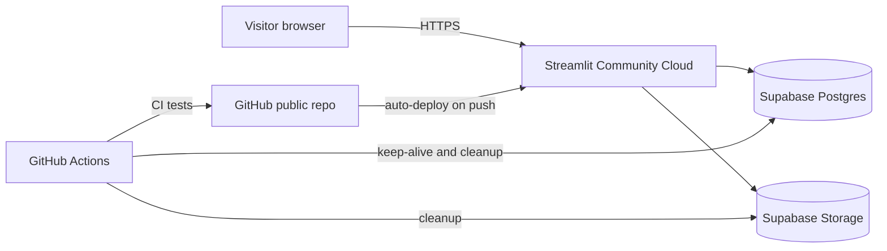
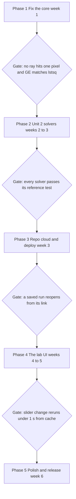

# Eigenslice: Audit and Upgrade Game Plan

Oct 13, 2026 · Mohammed Affan Khan

## Verdict

v3 runs, but it does not demonstrate CT reconstruction, and it barely uses Unit 2. Its projection matrix measures almost every pixel directly, so the "reconstruction" is exact by construction (error about 1e-31). Its mathematics is Gaussian elimination on the normal equations, which is not in the Unit 2 material at all. Unit 2 is Gram-Schmidt/QR, eigenvalues and eigenvectors, PCA and SVD, and v3 uses only one of those, as a table of numbers nobody interprets.

v4, the upgrade, is a hosted **Eigenslice** lab: a correct sparse projection model, and five solvers that each come from a Unit 2 concept and are compared on the same scan. Experiments are saved to cloud storage, can be shared by link, and the whole thing lives in a Git repo with tests and automatic deploys.

| | v3 (now) | v4 (target) |
| --- | --- | --- |
| Projection model | Exact-equality rays; 8 of 12 angles hit 1 pixel per ray | Fixed detector bins with intersection-length weights, sparse |
| Max size | 12x12x12 (dense A) | 64x64x64 and up (sparse A) |
| Unit 2 concepts used | SVD values listed, not used | QR, eigen, power iteration, SVD, truncated SVD, PCA all doing work |
| Realism | No noise, same A for data and solve | Noise, finer forward model than solve model, limited angles |
| Data | Recomputed in memory, lost on refresh | Experiments and volumes stored in Postgres and object storage |
| Delivery | Local `streamlit run`, zip file | Public URL, Git repo, CI tests, auto-deploy |

## Audit 1: the mathematics is wrong where it matters

Every number below was measured by running the v3 code, not estimated.

### M1. The projection matrix is mostly an identity matrix (critical)

`create_2d_projection_matrix` forms a ray only from pixels whose rounded detector coordinates are exactly equal. That only happens at 0°, 45°, 90° and 135°. At the other 8 angles every pixel gets its own ray.

| Angles | Rays at n=10 | Pixels per ray |
| --- | --- | --- |
| 0°, 90° | 10 each | 10 |
| 45°, 135° | 19 each | 5.3 |
| 15°, 30°, 60°, 75°, 105°, 120°, 150°, 165° | 100 each | **1.0** |

So 804 of 858 rows of A hit exactly one pixel. A contains the 100x100 identity 8 times. Every pixel is measured directly and nothing is being reconstructed.

### M2. The results are guaranteed, so they prove nothing (critical)

- Reconstruction error is about 1e-31 at every size. That is floating-point noise, not accuracy.
- cond(AᵀA) is about 5. A real CT matrix is ill-conditioned, and that difficulty is the whole subject.
- Rank(A) = 100/100 only because of M1. With just 0° and 90°, rank is 19/100.
- 1% measurement noise gives RMSE 0.003, because direct pixel readings barely amplify noise.

### M3. Inverse crime: same model for data and solve, no noise (major)

Data is made with the exact A used to solve, with no noise. Even a correct model looks perfect under these conditions. v4 must create data on a finer grid (or with a different ray model) than the one it reconstructs on, and add Poisson or Gaussian noise.

### M4. Normal equations square the condition number (major)

Solving AᵀAx = Aᵀb gives cond(AᵀA) = cond(A)². v3 hides this because cond is about 5. With a real A, it matters. Unit 2's QR decomposition solves least squares as Rx = Qᵀb without ever forming AᵀA. That is the textbook reason QR exists, and v3 ignores it.

### M5. No handling of rank deficiency (major)

With a correct binned model, 12 angles give rank 99/100 at n=10, and plain normal equations become singular. v3 would crash with a generic error. v4 needs truncated SVD or Tikhonov regularization, both measured below:

| Angles | Rank(A) | Plain normal equations | Tikhonov, λ = 0.1 |
| --- | --- | --- | --- |
| 4 | 43/100 | singular | RMSE 0.152 |
| 8 | 86/100 | singular | RMSE 0.079 |
| 12 | 99/100 | singular | RMSE 0.044 |
| 24 | 100/100 | exact | RMSE 0.015 |

### M6. The phantom is mostly empty (moderate)

The inner spheres use fixed ±2-voxel offsets but radii that scale with n, so they are tiny or missing. At n=8 the 1.45 and 1.2 structures have zero voxels; at n=12 the 1.2 structure is one voxel. The 3D view mostly shows the outer ellipsoid.

### M7. "3D" is really stacked 2D (moderate, but say it up front)

Each z-slice is solved on its own with the same 2D A. That is fine for parallel-beam CT, but the README's first line claims 2D X-rays reconstruct a 3D volume. Say "slice-by-slice parallel-beam" in the first sentence, or add a real 3D geometry in a later phase.

## Audit 2: visuals, code, performance and packaging

| # | Problem | Where | Severity | Fix in v4 |
| --- | --- | --- | --- | --- |
| V1 | "X-ray image" is one detector row repeated n times, presented as a 2D image | `projection_image` | High | Real radiograph: project every z-slice at angle θ and stack the rows |
| V2 | Sinogram is interpolated across uneven bins, so it is not what A measured | `sinogram_figure` | High | Sinogram = `(A @ x).reshape(n_angles, n_bins)`, the true measurements |
| V3 | 3D view shows a reconstruction identical to the original, so it teaches nothing | `volume_3d_figure` | Medium | Original, reconstruction and error volume side by side, with interactive slicing |
| V4 | Equation header shows as raw text: Streamlit markdown does not render `\[ \]` | `app.py` L28 | Low | `st.latex` |
| V5 | Threshold slider stops at 1.2, so 1.45 and 1.8 structures can never be isolated | `app.py` L41 | Low | Slider range from the volume's actual min and max |
| C1 | `"\["` is an invalid escape; Python 3.12+ warns and `-W error` makes it a SyntaxError | `app.py` L28 | Medium | Raw strings |
| C2 | `rank(A)` computed 3 times per rerun, each a full SVD | `app.py` L69, 105, 148 | Medium | Compute once, cache |
| C3 | AᵀA rebuilt and fully eliminated for every slice, n copies stored | `reconstruct_volume` | Medium | Factor once (QR or Cholesky), solve every slice against it |
| C4 | Solver never tested against a reference; pivot tolerance 1e-12 does not scale with the matrix | `gaussian_elimination` | Medium | pytest against `np.linalg.lstsq`; relative tolerance |
| C5 | Bare `except Exception` swallows singularity instead of explaining it | `app.py` L59 | Medium | Detect rank deficiency, tell the user why, suggest regularization |
| C6 | Generate button does nothing; results recompute on n change anyway | `app.py` L43 | Low | Remove, or make it the "run experiment" action that saves to the cloud |
| C7 | Old and new width APIs mixed; `use_container_width` is past its removal date and logs a warning on every render | `app.py` | Low | `width="stretch"` everywhere |
| C8 | `slice_fig` built but never shown, only downloaded | `app.py` L124 | Low | Show it or drop it |
| P1 | 8.4 s rerun after moving one slider (12 figures + ZIP + 3D redrawn every time) | `app.py` | High | Cache figures; build the ZIP only when clicked; precompute in the experiment run |
| P2 | Dense A cannot scale: a 64x64 slice with 180 angles is about 16k x 4k, roughly 0.5 GB dense | `projection.py` | High | `scipy.sparse` CSR matrix, a few MB |
| K1 | Zip named v3, folder inside named v2 | packaging | Low | Git tags and releases replace zip versioning |
| K2 | `__pycache__/*.pyc` shipped | packaging | Low | `.gitignore` |
| K3 | `requirements.txt` unpinned, yet code needs a recent Streamlit | packaging | Medium | Pinned versions in `pyproject.toml` with a lockfile |
| K4 | UI text says SVD is shown "because it is explicitly in your Unit 2 syllabus": an AI assistant's voice pasted into the product | `app.py` L153 | High (credibility) | Rewrite every user-facing string yourself |

The Unit 2 solution notebooks carry the same tell: each starts with a leftover citation token like `fileciteturn2file2L2-L29`. Strip those before anything you submit builds on them.

## Unit 2 mapping: every topic gets a real job

Your Unit 2 folder covers four topics: Gram-Schmidt/QR, eigenvalues and eigenvectors, PCA and SVD. v3 uses none of them for actual work. In v4, each one becomes a solver or an analysis that answers a question about the scan.

| Unit 2 topic (your sheet) | v3 | v4 job | Question it answers |
| --- | --- | --- | --- |
| Gram-Schmidt, QR (Topic 1, Q3) | Not used | Own modified Gram-Schmidt QR, then solve Rx = Qᵀb by back substitution | Why is QR safer than normal equations? |
| Eigenvalues, diagonalization (Topic 2) | Not used | Eigen-decomposition of AᵀA; power iteration for the largest eigenvalue, which sets the iterative solver's step size | How fast can an iterative solver go before it blows up? |
| SVD (Topic 3, incl. Q3: σ = √λ(AᵀA)) | Singular values listed in a table | Truncated SVD solver; Picard plot; null-space images | Which image patterns can this scanner never see? |
| PCA (Topic 3, Q2–Q3) | Not used | "Eigen-phantoms" learned from a training set; reconstruct with only k PCA coefficients | Can prior knowledge rescue a 4-angle scan? |

### The formulas v4 implements

QR least squares (Unit 2, Topic 1), never forming AᵀA:

```latex
A = QR,\quad Q^{T}Q = I \;\Rightarrow\; \min_x \lVert Ax-b \rVert_2 \iff Rx = Q^{T}b
```

Conditioning, the reason QR wins:

```latex
\kappa(A^{T}A) = \kappa(A)^{2} = \left(\frac{\sigma_{\max}}{\sigma_{\min}}\right)^{2}
```

Truncated SVD (Unit 2, Topic 3), keeping the k largest singular values:

```latex
x_k = \sum_{i=1}^{k} \frac{u_i^{T} b}{\sigma_i}\, v_i
```

Tikhonov regularization seen through the SVD, as filter factors:

```latex
x_\lambda = \sum_{i} \frac{\sigma_i^{2}}{\sigma_i^{2}+\lambda} \cdot \frac{u_i^{T} b}{\sigma_i}\, v_i
```

Landweber iteration, with the step size set by an eigenvalue found by power iteration (Unit 2, Topic 2):

```latex
x^{(t+1)} = x^{(t)} + \omega A^{T}\left(b - A x^{(t)}\right), \qquad 0 < \omega < \frac{2}{\lambda_{\max}(A^{T}A)}
```

PCA subspace reconstruction (Unit 2, Topic 3): mean phantom μ, top-k eigenvectors W of the training covariance:

```latex
x = \mu + Wc, \qquad \min_{c} \lVert A(\mu + Wc) - b \rVert_2 \;\text{(a k-unknown problem solved by QR)}
```

### Concepts added beyond Unit 2

- **Gaussian elimination / LU** (kept from v3, now as the baseline everything is compared against).
- **Sparse matrices** (CSR), so 64x64 slices fit in memory.
- **Ray tracing with intersection lengths** (Siddon-style), for a physically weighted A.
- **Filtered back projection**, the classical clinical method, as a reference result.
- **CGLS** (conjugate gradient on least squares), the fast iterative solver for large sizes.

Rule for the build: implement QR, power iteration and the solvers yourself, and use NumPy and SciPy only to verify them in tests. That keeps the Unit 2 content as your own work.

## What v4 does

v4 is an interactive lab where you build a scan, reconstruct it with several solvers, see why each one succeeds or fails, and save the experiment to the cloud with a shareable link. Six pages:

1. **Scanner.** Pick a phantom: 3D Shepp-Logan, random ellipsoids with a seed, or your own uploaded PNG slice. Set size (16 to 64), number of angles, angular range (to simulate limited-angle scans) and noise level. Shows a real radiograph at any angle and the true sinogram.
2. **Reconstruct.** Run any mix of solvers on the same data: Gaussian elimination (baseline), QR, truncated SVD, Tikhonov, Landweber, CGLS, PCA subspace and filtered back projection. Each gets its own parameter (k, λ, iterations). Output: side-by-side slices, error maps, RMSE, PSNR and SSIM, and convergence curves for the iterative solvers.
3. **Matrix lab.** The linear algebra made visible: sparsity pattern of A, singular value spectrum, condition numbers of A and AᵀA, the Picard plot, and the null-space images (right singular vectors with near-zero σ). Also shows orthogonality loss ‖QᵀQ − I‖ for classical vs modified Gram-Schmidt.
4. **PCA lab.** Eigen-phantoms learned from 500 training phantoms, explained-variance curve, and a k slider showing reconstruction quality vs number of components.
5. **3D viewer.** Orthogonal slices and an isosurface of original, reconstruction and error, rendered in the browser with Plotly.
6. **Experiments.** Every run saved with its parameters, metrics and files. Open any past run by link, compare two runs side by side, download volumes (.npz) and figures (.png).

### What makes it a drastic upgrade

- **Honest physics:** data generated on a 2x finer grid than the solve grid, plus noise, so no solver gets a free perfect answer.
- **Failure is a feature:** when normal equations go singular, the app says so, shows the rank, and points to the regularized solvers instead of crashing.
- **Experiments persist:** results live in a cloud database, so a reviewer can open your exact run from a link.
- **One finding per page:** each page ends with a one-line conclusion drawn from the numbers, e.g. "At 8 angles, truncated SVD with k = 60 beats Tikhonov on RMSE", filled in from that run's actual numbers, never hard-coded.

## Architecture: ₹0 a month, no card needed

The whole stack runs on three free tiers that need no payment method: GitHub for code and automation, Streamlit Community Cloud for the app, Supabase for the database and file storage. Everything else that looks tempting either needs a card or adds a second server without adding value.

| Layer | Service (free tier) | Limits that matter ([checked 13 Oct 2026](https://supabase.com/pricing)) | How v4 lives within them |
| --- | --- | --- | --- |
| Code, CI, scheduled jobs | GitHub public repo + GitHub Actions | Free for public repos | Tests on every push; weekly keep-alive job |
| App + compute | [Streamlit Community Cloud](https://docs.streamlit.io/deploy/streamlit-community-cloud/manage-your-app) | Up to 2.7 GB RAM, 2 cores; sleeps after 12 h with no traffic (any visitor can wake it) | Sparse matrices; dense solvers capped at 32x32 per slice |
| Database | [Supabase](https://supabase.com/pricing) Postgres | 500 MB; project paused after 1 week inactive; 2 free projects | Only metadata and metrics in rows (a few KB per run) |
| File storage | Supabase Storage | 1 GB total; 50 MB per file; 5 GB egress a month | Volumes as compressed float16 .npz (under 0.5 MB at 64³); keep the newest 300 runs |

Diagram of the stack:



### Why not the "bigger" stack

- **FastAPI + Next.js** needs a second free host. Render's free tier [spins down after 15 minutes and takes about a minute to wake](https://render.com/docs/free), with a disk that is wiped on restart. That is two cold starts per visit and twice the code, for no gain in a numerics lab.
- **Google Cloud Run** has a generous [free monthly allowance](https://cloud.google.com/run/pricing), but it needs a billing account with a card. That breaks the "completely free" rule.
- **Streamlit is the right call here**, because all the work is Python and NumPy. The upgrade is in the mathematics, the data layer and the engineering, not in switching UI frameworks.

### Three rules that keep it free

1. **Supabase pauses after a week of no activity.** A GitHub Actions cron job runs a tiny query every 3 days, so the demo is never paused when someone opens it.
2. **Never store what can be recomputed.** The projection matrix and phantoms are rebuilt from parameters and a seed. Only reconstructions, metrics and figures are uploaded.
3. **Stay under 1 GB.** A cleanup job deletes files from the oldest runs beyond 300, while keeping their metadata rows, and any run you mark as "pinned".

### Secrets

The Supabase URL and service key go in Streamlit's secrets settings, never in the repo. Streamlit runs server-side, so the key never reaches the browser. Turn on row-level security in Supabase anyway, so a leaked anon key cannot write.

## Data model and cloud storage

Three tables in Postgres hold everything searchable. One storage bucket holds the heavy files, addressed by run id. A run is reproducible from its row alone, because phantom, geometry and noise are all generated from stored parameters plus a seed.

### Tables

| Table | Key columns | Purpose |
| --- | --- | --- |
| `experiments` | `id uuid`, `created_at`, `title`, `phantom jsonb`, `geometry jsonb`, `noise jsonb`, `seed int`, `code_version text`, `pinned bool` | One scan setup. `code_version` = the Git commit SHA, so every result traces to exact code |
| `runs` | `id uuid`, `experiment_id fk`, `solver text`, `params jsonb`, `rmse`, `psnr`, `ssim`, `runtime_ms`, `rank_a int`, `cond_a float`, `status text`, `error text` | One solver applied to one experiment. Failed runs are saved too, with the reason |
| `artifacts` | `id uuid`, `run_id fk`, `kind text`, `path text`, `bytes int` | Pointer to each file in storage: volume, sinogram, figure, convergence history |

### Storage layout

```
eigenslice/                      (one Supabase bucket)
  experiments/<experiment_id>/
    sinogram.npz                 (true measurements b)
    phantom.npz                  (only for uploaded phantoms)
  runs/<run_id>/
    volume.npz                   (float16, compressed)
    error.npz
    convergence.json             (iterative solvers only)
    slice_mid.png
```

### Flow of one experiment

1. You set parameters and press **Run**.
2. The app checks the cache; on a miss it builds A (sparse) and the data b, then runs the chosen solvers.
3. It inserts the `experiments` row, then one `runs` row per solver, uploads files, then inserts `artifacts` rows.
4. The URL becomes `?exp=<id>`. Anyone opening that link loads the rows and files instead of recomputing.

If an upload fails halfway, the run row is marked `status = 'partial'`, so the UI never shows a result with missing files.

### Size budget

| Item | Size | Per run |
| --- | --- | --- |
| 64³ volume, float16, compressed | about 0.3–0.5 MB | 2 (volume + error) |
| Figures and JSON | about 0.2 MB | 1 set |
| Database rows | a few KB | 1 + one per solver |

At about 1.2 MB per 64³ run, 1 GB holds roughly 800 runs, so the 300-run retention rule leaves plenty of headroom. Smaller sizes cost far less.

## Git repo, workflow and CI

One public GitHub repo. The maths is a plain Python package with no Streamlit inside it, so it can be tested on its own, and the app is a thin layer on top.

### Layout

```
eigenslice/
  pyproject.toml              pinned dependencies, ruff + pytest config
  README.md                   one-line claim, live link, screenshots, how to run
  .gitignore                  __pycache__, .venv, .streamlit/secrets.toml, *.npz
  .streamlit/config.toml      theme only, no secrets
  src/eigenslice/
    phantoms.py               shepp_logan_3d, random_ellipsoids(seed), from_image
    geometry.py               parallel-beam rays, Siddon intersection lengths
    operators.py              sparse A builder, forward / back projection
    noise.py                  Poisson and Gaussian noise
    linalg/
      gauss.py                Gaussian elimination with partial pivoting (from v3, fixed)
      gram_schmidt.py         classical + modified Gram-Schmidt, QR solve
      eigen.py                power iteration, AᵀA eigen analysis
      svd_tools.py            truncated SVD, Picard data, null-space images
      pca.py                  eigen-phantom training and subspace solve
    solvers/                  one file per solver, same signature: solve(A, b, **params) -> Result
    metrics.py                RMSE, PSNR, SSIM
    storage.py                Supabase reads and writes, the only file that knows about the cloud
  app/
    Home.py                   Streamlit entry point
    pages/                    1_Scanner.py ... 6_Experiments.py
  tests/                      pytest, one file per module
  notebooks/                  derivations and figures for the report
  supabase/migrations/        SQL for the three tables + row-level security
  .github/workflows/
    ci.yml                    lint + tests on every push and pull request
    keepalive.yml             cron every 3 days, pings Supabase
    cleanup.yml               weekly, enforces the 300-run storage rule
```

### How you work in it

- `main` is always deployable; Streamlit Cloud deploys it automatically on every push.
- New work goes on a short branch (`feat/qr-solver`, `fix/phantom-scaling`), merged by pull request only when CI is green. Even working alone, this gives you a reviewable history.
- Commit messages in the form `feat: add modified Gram-Schmidt QR solver`.
- Tag each milestone (`v4.0-alpha`, `v4.0`) and attach release notes. Tags replace zip files named v2 or v3.

### Tests that must exist before the UI

- [ ] Each solver matches `np.linalg.lstsq` on a small full-rank problem to 1e-8.
- [ ] QR: QᵀQ = I and QR = A to 1e-10; modified Gram-Schmidt loses less orthogonality than classical on an ill-conditioned matrix.
- [ ] Power iteration matches the largest eigenvalue from `np.linalg.eigvalsh` to 1e-6.
- [ ] σᵢ = √λᵢ(AᵀA), the same check as your SVD sheet, Question 3.
- [ ] Every ray in the new A hits more than one pixel (the regression test for v3's main bug).
- [ ] Plain normal equations raise a clear "rank deficient" error at 4 angles.
- [ ] Phantom structures have a nonzero voxel count at every supported size.

## Roadmap

Six weeks at a student pace, in five phases. Nothing moves to the next phase until its gate passes. Phase 1 is highlighted because it fixes the bug that invalidates everything else. The week counts are my estimate, so stretch them to fit your semester.



- **Phase 1, the core:** sparse A with fixed detector bins and intersection lengths; phantom that scales with n; 3D Shepp-Logan; noise and a 2x finer data grid; pytest suite; Gaussian elimination kept as the baseline.
- **Phase 2, the Unit 2 solvers:** modified Gram-Schmidt QR, power iteration with Landweber, truncated SVD, Tikhonov; PCA eigen-phantoms from 500 training phantoms; CGLS for 64x64 slices.
- **Phase 3, repo, cloud and deploy:** GitHub repo with CI, Supabase tables and bucket, `storage.py`, deploy to Streamlit Community Cloud; keep-alive and cleanup workflows; secrets in Streamlit settings only.
- **Phase 4, the lab UI:** Scanner, Reconstruct, Matrix lab, PCA lab, 3D viewer and Experiments pages; cached results; each page ends with a one-line finding drawn from its numbers.
- **Phase 5, polish and release:** README with live link and GIF, report notebook, filtered back projection as the reference result; tag v4.0 with release notes.

If time runs short, Phases 1 to 3 alone already beat v3 on every point in the audit. Phases 4 and 5 make it impressive.

## Risks, limits and what not to do

| Risk | Likelihood | What happens | Mitigation |
| --- | --- | --- | --- |
| Dense SVD/QR too slow at 64x64 | High | A is about 16k x 4k; a full SVD takes minutes and about 0.5 GB | Dense solvers capped at 32x32; precompute the SVD once per geometry and cache it |
| App asleep when a reviewer opens it | Medium | Streamlit sleeps after 12 h idle; the wake button takes a short wait | Open the link yourself before any demo; put a screenshot and GIF in the README |
| Supabase project paused | Medium without the cron job | Experiments page fails to load | `keepalive.yml`; the app degrades to "compute only" mode if the database is unreachable |
| Storage passes 1 GB | Low with cleanup | Uploads fail | `cleanup.yml`; float16 compression; no matrices stored |
| Public write access abused | Low | Junk runs fill storage | Row-level security; per-session rate limit (e.g. 10 runs per hour); size caps on uploads |
| Free-tier terms change | Low, but outside your control | A service limits or ends its free plan | `storage.py` is the only cloud-aware file, so swapping providers touches one module |
| Scope creep | High | Nothing ships | Ship Phase 1–2 first; Phases 3–5 are each optional on top |

### Do not

- **Do not** call it 3D CT from 2D X-rays without saying "slice-by-slice, parallel beam" in the same sentence.
- **Do not** present a 1e-31 error as a result. If a number looks perfect, the test is rigged.
- **Do not** use `np.linalg.pinv` or `lstsq` inside the solvers. They belong only in tests, as the reference answer.
- **Do not** paste AI-written text into the UI or README unedited. Read every line aloud; if it addresses "you" or the syllabus, rewrite it.
- **Do not** commit secrets. Add `.streamlit/secrets.toml` to `.gitignore` before the first commit, not after.
- **Do not** use real patient scans. If you want real data, use a public research dataset and cite it, or stay with synthetic phantoms.
